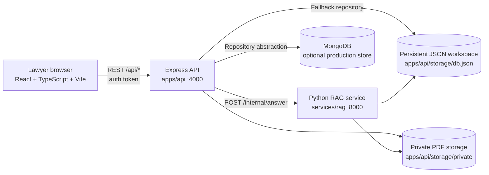
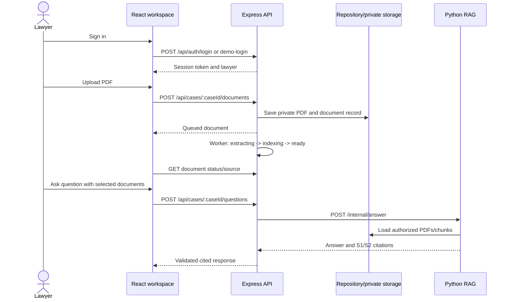
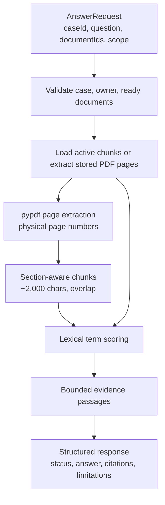

# LegalMind Detailed Architecture and Code Guide

## 1. Purpose

LegalMind is a private, lawyer-oriented legal document workspace. It combines:

- A React and TypeScript web application for cases, documents, source review, and cited questions.
- An Express and TypeScript API for authentication, authorization, persistence, uploads, jobs, retrieval orchestration, and saved answers.
- A Python FastAPI RAG service for PDF extraction, chunking, lexical retrieval, and evidence-backed responses.

The current implementation uses persistent JSON storage when MongoDB is unavailable. The storage boundary is isolated so the API can move to MongoDB or another production repository without changing the web components.

## 2. System architecture



## 3. Repository layout

```text
LegalMind/
├── apps/
│   ├── web/                         # React client
│   │   └── src/
│   │       ├── api/client.ts        # UI-facing API abstraction
│   │       ├── app/                 # Layout and route guards
│   │       ├── components/          # Upload, source viewer, Q&A UI
│   │       ├── context/AuthContext.tsx
│   │       ├── pages/               # Route-level screens
│   │       └── types/contracts.ts   # Frontend domain contracts
│   └── api/                         # Express backend
│       └── src/
│           ├── middleware/          # Auth, request IDs, errors
│           ├── modules/             # Feature modules
│           ├── worker/              # Document processing worker
│           ├── db/                  # Repository and workspace state
│           ├── storage/             # Private PDF files
│           └── types/domain.ts      # Backend records
├── services/
│   └── rag/                         # FastAPI extraction and RAG service
│       ├── app/main.py
│       └── ingestion/
└── test-case-pdfs/                  # Local PDF fixtures
```

## 4. Frontend architecture

### Routing and authentication

`src/main.tsx` defines public login and registration routes plus protected routes for the overview, cases, and case details. `RequireAuth` redirects unauthenticated users to `/login`. `AuthContext` loads the current lawyer and exposes login, demo login, registration, and logout actions.

`Layout.tsx` provides the authenticated shell:

- Sidebar navigation.
- Active lawyer badge and lawyer switching.
- API health indicator.
- Outlet for protected page content.

### API client boundary

`src/api/client.ts` is the only UI-facing data boundary. Components call methods such as `listCases`, `uploadDocument`, `askQuestion`, and `getSourcePage` rather than constructing HTTP requests themselves. This keeps the UI independent from whether the backend uses JSON storage, MongoDB, or a future Express deployment.

### Main user flow



## 5. Express API architecture

### Middleware

- `requireAuth.ts` resolves the session token and attaches the authenticated lawyer.
- `requestId.ts` gives requests traceable IDs.
- `errorHandler.ts` converts known `AppError` instances into stable error responses.
- CORS and JSON body limits are configured in `app.ts`.

### Feature modules

| Module | Responsibility |
|---|---|
| `auth` | Login, demo login, registration, session lookup, logout |
| `cases` | Case listing, ownership checks, case CRUD |
| `documents` | PDF validation, upload, status, source pages, deletion |
| `jobs` | Queue claiming and status transitions |
| `chunks` | Page-to-chunk materialization |
| `questions` | Scope validation, RAG delegation, citation validation |
| `retrieval` | Retrieval endpoint and evidence lookup |
| `conversations` | Conversation-related routes |
| `savedAnswers` | Save and list lawyer-owned answers |

Every owner-scoped service receives `ownerId` from authenticated middleware and filters records by that value. Client-supplied owner IDs are not trusted.

### Document ingestion

1. The browser reads the PDF and sends base64 content.
2. `documents/service.ts` validates extension, MIME type, and the 20 MB limit.
3. The API detects the PDF page-tree count and stores the bytes in private storage.
4. The upload creates a document record and queued job.
5. The worker advances the job through `extracting`, `indexing`, and `ready`.
6. PDF page text and section titles are stored in `pageContents`.
7. `chunks/service.ts` creates overlapping page chunks for retrieval.

The source viewer reads extracted page content. If no extracted content exists, it uses a clearly identifiable fallback preview; newly uploaded PDFs should populate real page text.

## 6. Python RAG architecture



`services/rag/app/main.py` exposes:

- `GET /health`
- `POST /internal/answer`

The answer contract uses server-issued source IDs (`S1`, `S2`) and includes document ID, version, chunk ID, physical page, excerpt, and availability. When evidence does not meet the relevance threshold, the service abstains with `insufficient_evidence` and no citations.

## 7. Data and ownership model

The primary records are:

- `LawyerRecord` and `SessionRecord`.
- `Case` owned by one lawyer.
- `CaseDocument` owned by one lawyer and attached to one case.
- `JobRecord` for asynchronous document processing.
- `ChunkRecord` linked to document, case, owner, and version.
- `QuestionResponse` and `SavedAnswer` linked to case and owner.

Ownership invariant:

```text
authenticated session -> lawyerId
lawyerId -> case.ownerId
case.ownerId -> document.ownerId
document.ownerId -> chunks/responses/saved answers
```

Deletion is soft deletion for documents. Existing citations are retained but marked unavailable so historical answers remain auditable without exposing deleted source content.

## 8. Operational commands

Run Node commands inside OrbStack:

```bash
cd /Volumes/Talha/Talha/Desktop/LegalMind/LegalMind/apps/api
npm i
npm run build
npm start
```

Start the RAG service:

```bash
cd /Volumes/Talha/Talha/Desktop/LegalMind/LegalMind/services/rag
.venv/bin/uvicorn app.main:app --host 127.0.0.1 --port 8000
```

Start the web app:

```bash
cd /Volumes/Talha/Talha/Desktop/LegalMind/LegalMind/apps/web
npm i
npm run dev -- --host
```

If port 4000 is already occupied, use an alternate API port and set `VITE_API_PROXY_TARGET` to the same port. See [RunScripts.md](./RunScripts.md).

## 9. Current implementation boundary

The current system is a working local Phase 1-3 implementation. MongoDB is optional and the JSON repository is the active fallback. Retrieval is intentionally lightweight and lexical rather than embedding/vector based. Production hardening should add managed secrets, durable queues, encrypted object storage, stronger PDF validation, observability, rate limits, and a production-grade vector/index layer.
