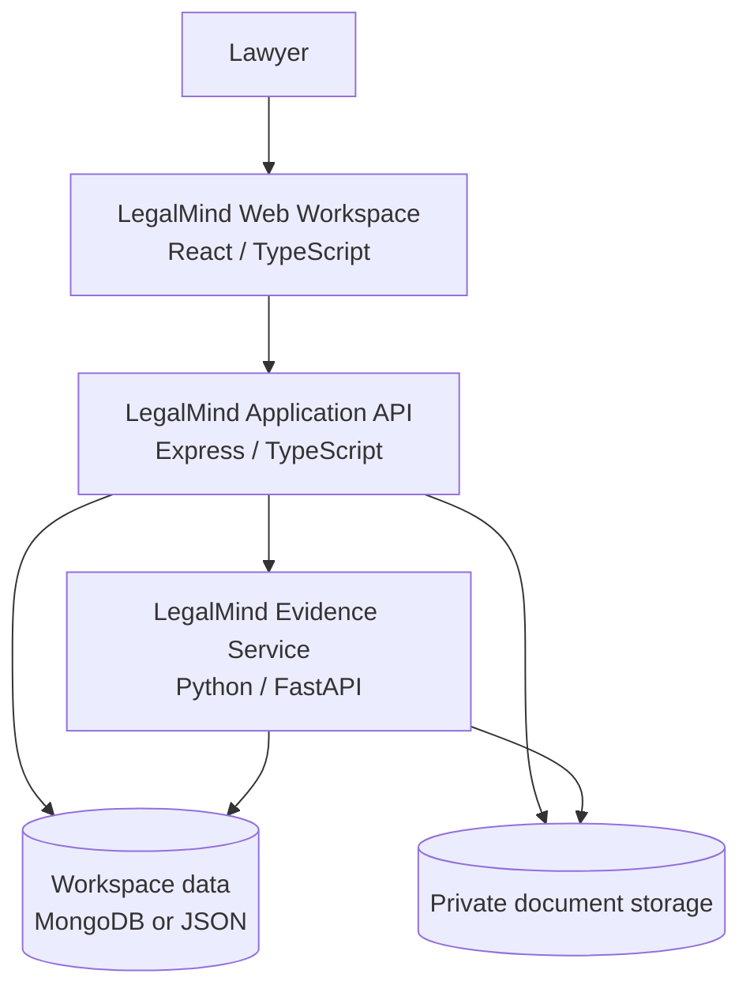
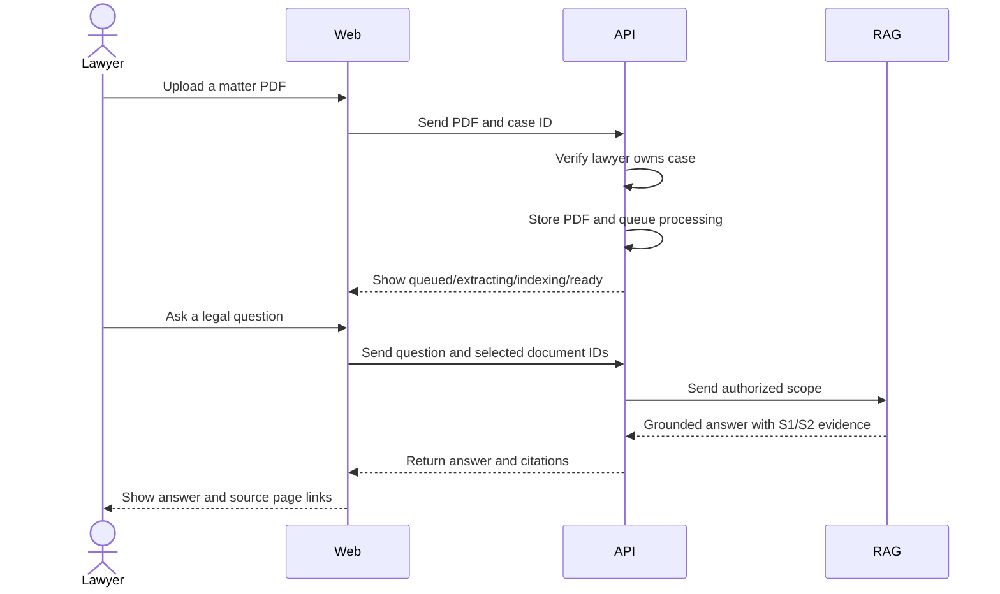

# LegalMind High-Level Architecture Overview

## Executive summary

LegalMind is a private legal intelligence workspace for lawyers. It organizes matters and source documents, processes uploaded PDFs, and answers questions with citations that point back to exact documents and physical pages.

The product has three cooperating layers:

1. **Web workspace** — the lawyer-facing application.
2. **Application API** — authentication, authorization, matter data, document lifecycle, and audit-friendly answer orchestration.
3. **RAG service** — document extraction, evidence retrieval, and grounded answer generation.

## High-level diagram

## What each layer does

### 1. Web workspace

Lawyers use the browser to:

- Sign in or create a lawyer account.
- Switch between matters they own.
- Upload and monitor legal PDFs.
- Open a source viewer and jump to a physical page.
- Ask questions against selected documents.
- Review inline citations and save useful answers.

The interface does not directly access storage or the RAG service. It communicates through the application API, which provides a controlled security boundary.

### 2. Application API

The API is the system’s policy and coordination layer. It:

- Identifies the active lawyer.
- Enforces lawyer ownership isolation.
- Stores cases, documents, jobs, responses, and saved answers.
- Stores uploaded PDFs in private storage.
- Runs the document processing lifecycle.
- Sends scoped questions to the RAG service.
- Validates returned citations before showing them to the lawyer.

This prevents a user from using a browser request to access another lawyer’s cases or documents.

### 3. Evidence and RAG service

The Python service:

- Reads PDF pages while preserving physical page numbers.
- Detects basic section titles.
- Creates overlapping evidence chunks.
- Ranks passages against a question.
- Returns bounded evidence and structured citations.
- Abstains when the selected scope does not contain relevant evidence.

The service does not decide which lawyer may access a case. The API supplies the ownership scope and validates the final response.

## End-to-end business flow

## Security and trust principles

- **Lawyer ownership isolation:** cases, documents, responses, and saved answers are filtered by the authenticated lawyer.
- **Private files:** uploaded documents are stored outside the public web directory.
- **Scoped retrieval:** questions include selected document IDs and case ownership scope.
- **Citation traceability:** answers identify the source document, version, chunk, and physical page.
- **Abstention over invention:** insufficient evidence produces an explicit insufficient-evidence response.
- **Deletion awareness:** deleted source citations remain visible as unavailable rather than silently disappearing.

## Current deployment view

For local development:

- Web app: `http://localhost:5173`
- Express API: `http://localhost:4000`
- Python RAG service: `http://127.0.0.1:8000`
- MongoDB: optional; JSON persistence is used when MongoDB is unavailable

The architecture is intentionally replaceable. The web application depends on API contracts, not on the current JSON implementation. The API can move to MongoDB, managed object storage, a durable queue, and a production vector index without requiring a redesign of the lawyer-facing workflows.

## Strategic next steps

For production readiness, prioritize:

1. Managed database and encrypted object storage.
2. Durable background jobs with retry and dead-letter handling.
3. Embedding/vector retrieval combined with lexical search.
4. Stronger tenant isolation, secrets management, and audit logging.
5. Monitoring for ingestion failures, retrieval quality, latency, and citation validity.
6. Formal access policies for firms, teams, matter roles, and document confidentiality.

## Audience takeaway

LegalMind separates the user experience, application policy, and evidence intelligence layers. This separation makes the platform easier to secure, test, scale, and evolve while preserving the core promise: every answer should be grounded in the lawyer’s authorized matter documents.
